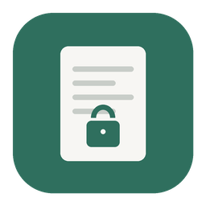
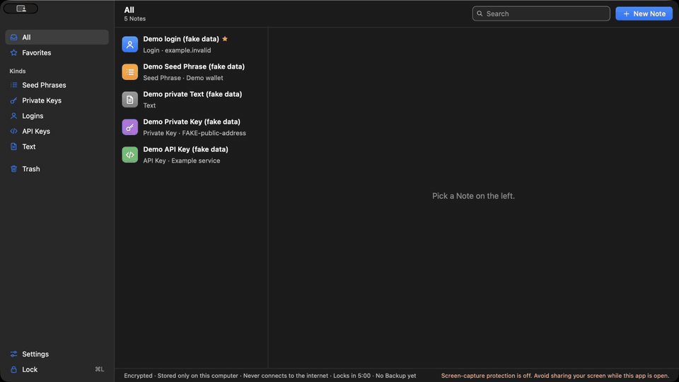

<div align="center">



# encrypted-note

An offline, encrypted vault for seed phrases, private keys, passwords and API keys, designed to be easy and safe for AI agents to use.

[](LICENSE)


<a href="docs/assets/product-demo.mp4"></a>

<sub>Recorded on macOS with fictional data · <a href="docs/assets/product-demo.mp4">full video (36 s)</a> · <a href="docs/assets/product-demo.md">transcript</a></sub>

</div>

## Features

- **Offline.** No network code, accounts, sync, updater or telemetry. Your Vault is one encrypted file on your computer.
- **Hidden by default.** Secrets stay as dots until you choose Show. Seed Phrases and Private Keys also need your Master Password.
- **Careful on screen shares.** Asks the OS to keep the window out of captures (best effort) and covers it when a screen-sharing app is running.
- **Recoverable.** A Recovery Key you write down at setup, and an [Emergency Reader](docs/guide.md#if-the-app-wont-open) that opens your Vault without the app.
- **Portable.** Copy the Vault file to a USB stick to open it on another computer.

> [!WARNING]
> v1 personal project, not independently audited. Keep a paper or metal backup of any seed phrase that holds real funds.

## Build

Needs Rust 1.89+, Node 24+, and on Mac the Xcode command-line tools.

```bash
npm ci --ignore-scripts
npm run tauri dev   # run in development
npx tauri build     # build the app
```

Run `./scripts/check.sh` (tests, clippy, cargo-deny, TypeScript) before a pull request. Debug builds read `ENOTE_DEV_DATA_DIR=<folder>` to keep your real Vault untouched, and `ENOTE_DEV_ALLOW_CAPTURE=1` to allow screenshots; release builds ignore both.

## Agent safety

AI coding agents are instructed to follow [AGENTS.md](AGENTS.md):

- Use obviously fake secrets in code, tests, docs, local issues and commits. Never include real passwords, keys or seed phrases.
- Keep the app offline: no HTTP clients, updaters, telemetry, crash reporters or analytics.
- Keep keys and decrypted Notes in the Rust core. The WebView receives only one Hidden Field at a time.
- Add dependencies only when clearly needed, pin exact versions, and explain why in the PR or local issue.

Agents should test with fictional data in a separate development Vault using `ENOTE_DEV_DATA_DIR` and run the checks described above before a pull request.

## Docs

- [Security model](docs/security-model.md): what it protects against, how it works, what has been tested
- [User guide](docs/guide.md): keyboard shortcuts, and reading your Vault if the app won't open
- [File format](docs/FORMAT.md) · [Design decisions](docs/adr/) · [Glossary](CONTEXT.md)

## License

[MIT](LICENSE). The passphrase generator uses the [EFF Long Wordlist](https://www.eff.org/dice) ([CC BY 3.0 US](https://creativecommons.org/licenses/by/3.0/us/)). Seed Phrase checks use the BIP39 English word list via the [`bip39`](https://crates.io/crates/bip39) crate.
