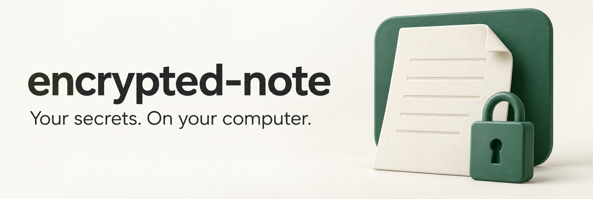

# encrypted-note



encrypted-note is a local-only desktop app for storing Seed Phrases, Private Keys, Logins, API Keys, and private text notes in one encrypted Vault on macOS and Windows.

- **Local by design.** Your Vault stays on your computer. The app has no network code, accounts, syncing, updater, telemetry, or analytics.
- **Recovery you control.** Choose your Master Password or use the app's six-word suggestion. Write down the Recovery Key shown once during setup and keep it in a paper Recovery Kit.
- **Private by default.** Hidden Fields stay concealed until you choose Show and hide again when you open another Note. Logins, API Keys, and Text use a 30-second reveal. Seed Phrases and Private Keys require the Master Password for viewing or editing and offer hold-to-show or a 20-second timed reveal.
- **Screen-sharing safeguards.** Capture Hiding is best-effort and asks the OS to exclude the app window. The Sharing Guard covers the window when known screen-sharing or recording apps are detected.
- **Portable backups.** The Vault is one encrypted file. Create a Backup to open it on another computer; transfers are manual and encrypted-note does not sync data.

Vault keys and decrypted Notes remain in the Rust core. The WebView receives only the Hidden Field you choose to reveal.

> **Status: v1, personal project, not independently audited.** Keep an offline paper or metal backup of any Seed Phrase that holds real funds. This app is a convenient extra copy, not your only one.

## What it protects against, and what it can't

| Protects | Doesn't protect |
|---|---|
| A stolen laptop or USB stick (Argon2id + XChaCha20-Poly1305, strong password required) | Malware already running on your computer (keyloggers, memory readers) |
| Someone at your unlocked computer (Auto-lock, re-entering the password for wallets, hold-to-show) | A phone camera pointed at your screen |
| Accidentally showing secrets while screen sharing (layered, see below) | A hacked operating system, or being forced to unlock |
| Clipboard history and Universal/cloud clipboard (private clipboard, cleared after 30 s) | Old copies of your Vault: they still open with the old password |

**Screen-capture hiding is best-effort on Mac.** Apple offers no API that guarantees it. Windows' exclusion is much stronger but still not a security boundary. That's why the app layers it with hidden-by-default fields and the Sharing Guard. See [ADR-0002](docs/adr/0002-screen-capture-hiding-is-layered-and-best-effort-on-mac.md).

## How it works

- **Tauri v2.** React/TypeScript screens run in an untrusted webview. A Rust core holds every key and decrypted Note, and hands the screens only the one field you're showing ([ADR-0003](docs/adr/0003-tauri-with-secrets-kept-in-rust.md)).
- **Encryption.** Argon2id is calibrated on your machine (≥ 64 MiB). A random Vault Key and a separate Wallet Key are wrapped by your Master Password and by your Recovery Key ([ADR-0004](docs/adr/0004-wallet-kinds-under-a-separate-key.md), [ADR-0005](docs/adr/0005-password-change-rewraps-key-rotation-is-separate.md)). The file format is documented byte by byte in [docs/FORMAT.md](docs/FORMAT.md).
- **Backups.** A Backup is just a copy of the Vault file you save wherever you like (e.g. an exFAT USB stick) and open on your other computer. There's no sync by design ([ADR-0001](docs/adr/0001-local-only-vault-moved-by-hand.md)).
- **Emergency Reader.** `crates/reader` is a small command-line tool that reads a Vault or Backup even if the app stops working.
- **Vocabulary.** [CONTEXT.md](CONTEXT.md) defines Vault, Note, Kind, Hidden Field, Recovery Kit and the rest.

## Build and run

Requirements: Rust 1.89+, Node 24+, and on Mac Xcode's command-line tools.

```bash
npm ci --ignore-scripts
npm run tauri dev                   # development
npx tauri build                     # release app bundle
cargo run -p enote-reader -- <file> # Emergency Reader
./scripts/check.sh                  # tests, clippy, cargo-deny (network ban), TypeScript
```

For experiments, debug builds read `ENOTE_DEV_DATA_DIR=/some/folder` so your real Vault is never touched. `ENOTE_DEV_ALLOW_CAPTURE=1` turns screen-capture hiding off, for screenshots while developing. Release builds ignore both.

## Tested so far

- **Automated:** 320 tests, including tamper tests over every byte of a Vault file and the RFC 9106 and XChaCha20-Poly1305 reference vectors.
- **By hand on macOS 26:** the main flows, clipboard privacy markers, the Sharing Guard with real apps, and a Backup read back by the Emergency Reader. Screen-capture results so far: [docs/capture-test.md](docs/capture-test.md).
- **Windows:** the adapters compile but have **not yet been run on a real Windows PC**.

## Credits

- The passphrase generator uses the [EFF Long Wordlist](https://www.eff.org/dice) by the Electronic Frontier Foundation, licensed [CC BY 3.0 US](https://creativecommons.org/licenses/by/3.0/us/).
- Seed Phrase checks use the BIP39 English word list via the [`bip39`](https://crates.io/crates/bip39) crate.

## License

[MIT](LICENSE)
