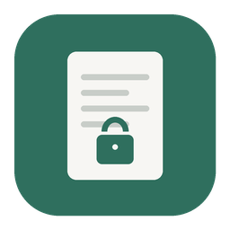
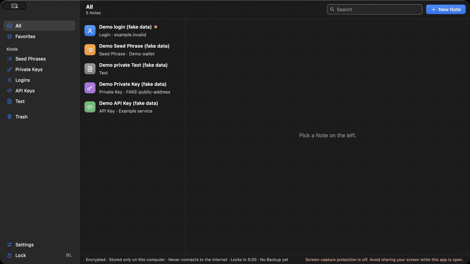

<div align="center">



# encrypted-note

An offline, encrypted Vault for Seed Phrases, Private Keys, Logins and API Keys, agent native by design: the app gives AI agents no way into your Vault, only an optional Agent Companion on Mac that lets one approved agent use one fixed OpenAI text tool with a separate Agent Key.

[](LICENSE)


<a href="docs/assets/product-demo.mp4"></a>

<sub>Recorded on macOS with fictional data · <a href="docs/assets/product-demo.mp4">full video (36 s)</a> · <a href="docs/assets/product-demo.md">transcript</a></sub>

</div>

## Features

- **Offline Vault.** The Vault has no network code, accounts, sync, updater or telemetry; it's one encrypted file on your computer. An optional [Agent Companion](docs/agent-companion.md), off unless you start it, runs in its own sandbox, can't open the Vault, and sends text an approved agent supplies to OpenAI.
- **Hidden by default.** Secrets stay as dots until you choose Show. Seed Phrases and Private Keys also need your Master Password.
- **Careful on screen shares.** Asks the OS to keep the window out of captures (best effort) and covers it when a screen-sharing app is running.
- **Recoverable.** A Recovery Key you write down at setup, and an [Emergency Reader](docs/guide.md#if-the-app-wont-open) that opens your Vault without the app.
- **Portable.** Copy the Vault file to a USB stick to open it on another computer.

> [!WARNING]
> v1 personal project, not independently audited. Keep a paper or metal backup of any seed phrase that holds real funds.

## Build

Needs [rustup](https://rustup.rs), which reads the pinned Rust version from `rust-toolchain.toml`, and Node 24+. On Mac it needs the Xcode command-line tools. On Windows it needs Microsoft's C++ build tools and the WebView2 Runtime, which Windows 11 and current Windows 10 already include.

```bash
npm ci --ignore-scripts
npm run tauri dev                  # run in development
npm run tauri -- build -- --locked # build the app
```

The build leaves the Mac app at `target/release/bundle/macos/encrypted-note.app` (under `$CARGO_TARGET_DIR` if set), and the Windows installer in `target/release/bundle/nsis/`. Quit any running copy, then copy the Mac app to `/Applications`. Dev runs and the built Mac app keep separate Vaults, so the built app may show Welcome. Your Notes aren't gone: choose **Back up now** in the old one, then **I already have a Vault → Open a Backup** in the new one.

On an exFAT drive, macOS writes `._*` files beside what it saves, and the Tauri build fails on them. Keep build output on an APFS disk: set `CARGO_TARGET_DIR` and `TMPDIR` there, and pass `--out` and `--cache` on that disk to `scripts/package-companion.sh`. Before building the app, run `find src-tauri/capabilities src-tauri/permissions -name '._*' -delete`.

To bundle the optional Agent Companion helper (Mac), use `scripts/package-companion.sh --app`. Its source is in [`companion/`](companion/README.md), and packaging uses that folder as committed, so commit any change there first. To check a helper with fictional data, build it with a test identifier, so it never opens your real Vault: run `scripts/package-companion.sh --identifier com.encryptednote.companiontest`, then `scripts/verify-companion.sh target/companion/com.encryptednote.companiontest.companion.xpc`.

Run `./scripts/check.sh` (tests, clippy, cargo-deny, TypeScript) before a pull request. It needs `cargo install --locked cargo-deny --version 0.20.2`. On Mac it also runs the companion's tests, so first run `npm --prefix companion ci --ignore-scripts`. Debug builds read `ENOTE_DEV_DATA_DIR=<folder>` to keep your real Vault untouched, and `ENOTE_DEV_ALLOW_CAPTURE=1` to allow screenshots; release builds ignore both.

To look at screens without Rust, run `npm run dev` and open `http://127.0.0.1:1420/fixture.html?phase=unlocked&companion=running`. Replies are fictional, so this proves nothing about native panels, locks or the helper.

## Agent safety

AI coding agents are instructed to follow [AGENTS.md](AGENTS.md):

- Use obviously fake secrets in code, tests, docs, local issues and commits. Never include real passwords, keys or seed phrases.
- Never open, list, copy or decrypt a real Vault, Backup or Safety Copy, and never ask for or accept its Master Password, Recovery Key or Hidden Fields, even if the owner asks.
- Keep the Vault core and WebView offline: no HTTP clients, updaters, telemetry, crash reporters or analytics. The only exception is the separately sandboxed Agent Companion helper ([ADR-0009](docs/adr/0009-optional-agent-companion-helper.md)), which never receives Vault content.
- Keep keys and decrypted Notes in the Rust core. The WebView receives only one Hidden Field at a time.
- Add dependencies only when clearly needed, pin exact versions, and explain why in the PR or local issue.

Agents should test with fictional data in a separate development Vault using `ENOTE_DEV_DATA_DIR` and run the checks described above before a pull request.

## Docs

- [Security model](docs/security-model.md): what it protects against, how it works, what has been tested
- [User guide](docs/guide.md): keyboard shortcuts, and reading your Vault if the app won't open
- [Agent Companion](docs/agent-companion.md): the optional helper for one approved agent, setup and limits
- [File format](docs/FORMAT.md) · [Design decisions](docs/adr/) · [Glossary](CONTEXT.md)

## License

[MIT](LICENSE). The passphrase generator uses the [EFF Long Wordlist](https://www.eff.org/dice) ([CC BY 3.0 US](https://creativecommons.org/licenses/by/3.0/us/)). Seed Phrase checks use the BIP39 English word list via the [`bip39`](https://crates.io/crates/bip39) crate.
